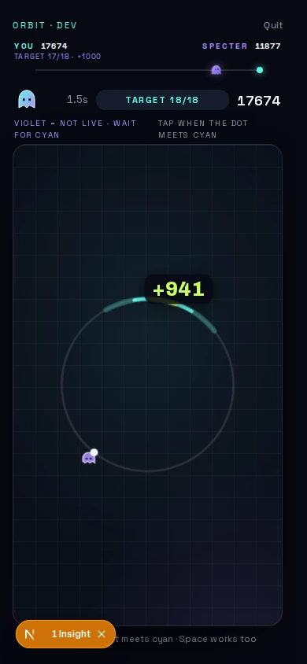
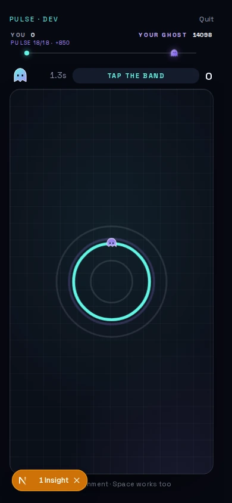

# Gameplay and page audit — 2026-10-24

## Behavior

- Owned past runs replay their recorded inputs and score changes on the run clock, independently of current-player input. Older stored past-self/challenge snapshots also get the race HUD. Raw choice inputs remain private to the owner; public rival ghosts retain the answer-free contract.
- Every game has action-position score feedback, at 26–36px for 1.6 seconds. Final feedback can finish before the result replaces the arena. Reduced motion keeps the label still.
- Pulse's cyan target changes size after each scoring window using a seeded sequence. Timing, authoritative scores, and recorded-run compatibility stay unchanged.
- Orbit pointer and keyboard controls both tap the moving marker. The score label is anchored to the marker's angle at input time. Public rival totals now use the scorer's interpolated points.
- Shift advances missed cards, displays the timeout feedback, and continues to the next scheduled card.
- Recall redraws immediately after canvas resizing and holds completion feedback before finishing.
- Trace updates score during movement. Owned replay trails use every recorded point, stay aligned with the ghost head, and break at separate strokes. Public trails retain their delay. Ghost sampling retains all gate calculations and the final endpoint/score.
- Archive replay draws the corresponding game board and stored actions instead of a generic timeline picture.
- Keyboard shortcuts preserve navigation controls, and game canvases are focusable.
- Fixed the Node-only telemetry import so webpack can eliminate it from Edge instrumentation.

## Verification

The app was run against an isolated local PostgreSQL-compatible PGlite database with the real schema migrations, authentication, APIs, and saved runs. Browser checks used Chromium 153. Local test users and test entitlements were used; no production data was changed.

| Check | Evidence |
| --- | --- |
| Unit suite | 291 tests, 41 files, passing |
| Focused game/page browser audit | All 12 scenarios passed: six full game runs, saved scores/replays, independent past ghosts, Shift timeout, keyboard Quit, all static pages at three widths, and dynamic pages/controls |
| Viewports | 320×740, 390×844, 1440×900; no horizontal overflow across `/`, `/play`, `/profile`, `/leagues`, `/archive`, `/archive/history`, `/ghost-plus`, `/settings`, `/privacy`, `/terms`, `/dev` |
| Dynamic pages | League creation/standings; challenge landing/preflight; running/results; replay pause/restart/speed/scrub; past-self access; missing challenge/league/run states |
| Action feedback | Browser assertions cover visible size, lifetime, Orbit impact coordinates, and rendered Pulse size changes; reduced-motion feedback checked |
| Release regression | Account deletion, analytics validation, free/premium access, league caps/permissions, duplicate/hostile submission, expired/disabled challenges, offline retry, safety and viewport/keyboard/load checks |
| Content | 30 deterministic days valid; none impossible. Existing Trace score-compression warnings remain |
| Schema | Drizzle check passed; no schema migration needed |
| Static checks | TypeScript, lint, and diff whitespace checks passed |
| Build | Webpack production build passed; source built in an isolated checkout |

The long challenge, Orbit, and Shift browser tests were repeated against the production server after development reloads interrupted initial attempts. The game/page audit and focused follow-up checks cover the final UI behavior.

## Limits

- Google OAuth verification requires configured provider credentials and is skipped when absent. A real Google account link was not attempted.
- Local test-payment entitlement confirmation was verified. Real Stripe checkout, renewal, and webhooks were not exercised without payment credentials.
- PGlite supports local flow verification; this is not production PostgreSQL concurrency/load testing. The temporary test connection pool was serialized to avoid PGlite wire-protocol multiplexing conflicts; no application pool settings were changed.
- The installed Next.js 16.4.0 CLI reported an existing security advisory. The build succeeded on the CLI's requested retry. Dependency upgrades are separate from these gameplay changes.
- Screenshots are desktop Chromium at phone viewport sizes, not physical-device or audio-listening acceptance.

## Preview startup follow-up — 2026-10-26

- Reproduced `403 INVALID_ORIGIN` in the real Better Auth handler when a preview request carries Vercel's protection cookie and only the production URL is trusted. Without a guest session, every game start then receives `401`.
- Preview authentication now accepts only the exact deployment and branch hosts supplied by Vercel, with callbacks resolved on the current host. Production and local authentication retain their configured URL; unrelated origins remain rejected.
- Bootstrap and game-start recovery share one guest sign-in. A `401` receives one authentication recovery attempt; charge and server failures are not blindly retried. Daily, Flash, archive, challenge and dev screens display specific start errors.
- Added 14 regressions covering actual preview guest creation and session-cookie reading, unrelated-origin rejection, bootstrap/Play concurrency, identity preservation, daily/Flash authentication recovery, charge rejection and HTML server errors. All 302 database-independent unit tests pass. The three database-backed rate-limit tests were not rerun during this follow-up.
- Live production checks created an isolated test guest and successfully opened daily and Flash sessions (`200` for both); the test account was deleted afterward. These are session-start checks, not completed production game runs.
- Vercel team authorization now works. Confirmed the deployed commit and required preview environment-variable names, fetched the protected Flash endpoint successfully (`200`), and queried recent runtime logs/error clusters without finding application exceptions. This does not establish the complete browser flow. Automatic approval review blocked the temporary share-link path for browser automation; the temporary links created for verification were revoked. Live protected-preview game starts remain unverified.

## Memory Leak and Flash follow-up — 2026-10-26

- Removed Recall's completion animation that re-flashed the old pattern. A long completion animation could overlap the following WATCH phase. Completed input now receives one brief tile confirmation and one score popup.
- Independent ghost inputs and keyboard-focus outlines no longer appear as extra tiles during WATCH. The ghost continues advancing in the race HUD and shows tile inputs during the answer phase.
- Correct intermediate tiles show answer progress rather than repeated zero-point popups. A wrong tile shows `MISS`; the hint explains that one wrong tile ends the pattern. Scores remain authoritative and unchanged.
- Newly generated Flash boards have roughly 10% more breathing room: fewer automatic prompts, slightly slower Orbit motion, and 880ms Recall slots instead of 800ms. Snap response windows and Recall answer allowances are slightly wider. Trace remains controlled by the player's hand.
- Existing persisted Flash boards are immutable so active sessions and their recorded ghosts keep their original configuration. The pace change applies from the next generated rotation; daily boards are unchanged.
- All 337 database-independent unit tests pass, including 35 Flash content checks. Two browser regressions pass against the local production build at 390×844, with API responses isolated: normal and Flash Recall timing, a 12-cell transition, ghost suppression during WATCH, absence of partial-input zero popups, completion points, and `MISS` feedback. These are real canvas/UI checks, not live database submission checks. The production build, TypeScript and lint pass. The three DB-backed rate-limit tests were not rerun in this follow-up.

## Screenshots

Orbit's score stays at the action's point on the ring:

An owned Pulse ghost advances while the current player has no inputs:

